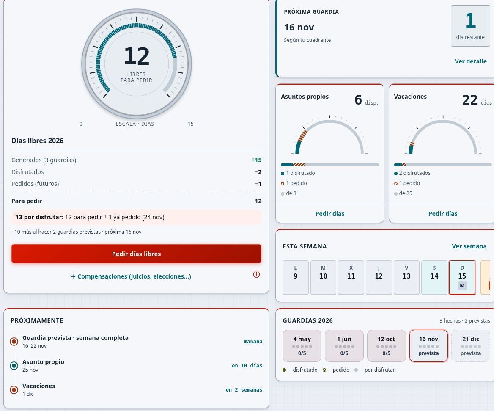
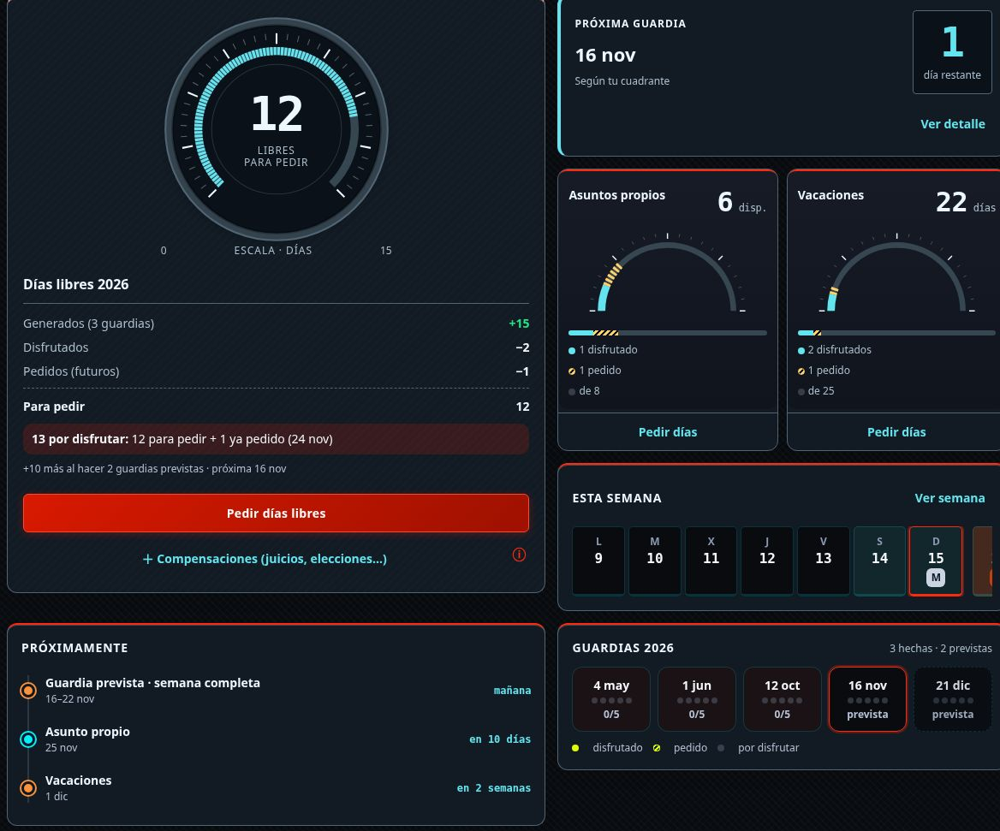
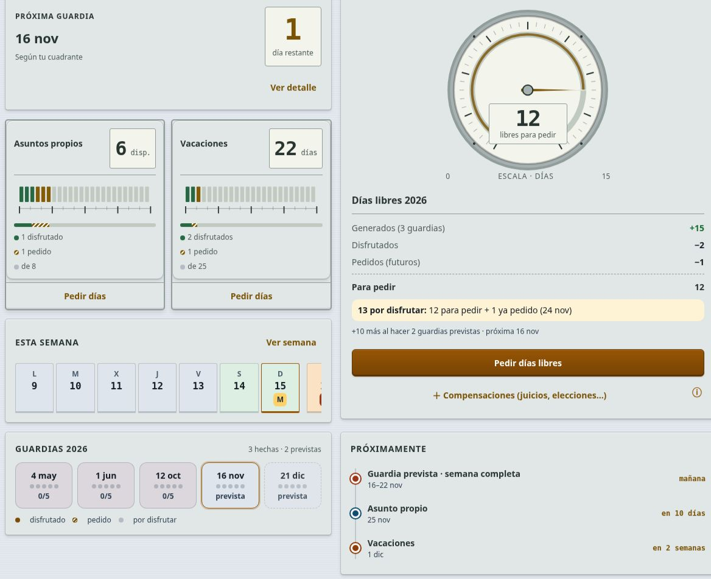
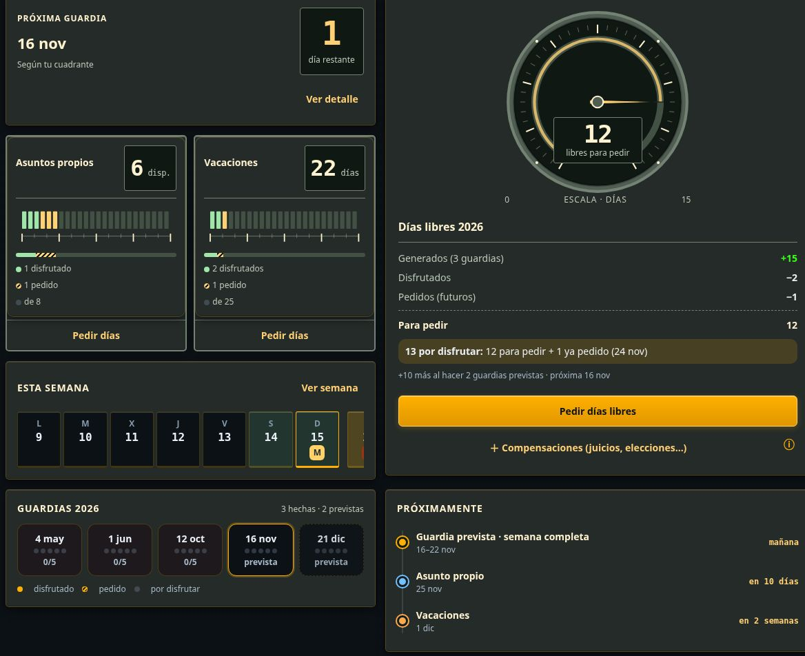

# Paneles instrumentales — verificación

15/11/2026. Rama `feat/instrumental-dashboards`, basada en `d10395698997a05e8b0b0aa85ad4706f325345e7`. Pruebas con perfil sintético, sin credenciales ni datos de compañeros.

## Resultados ejecutados

| Comprobación | Resultado |
|---|---|
| `npm test` | 310 pruebas, 0 fallos, incluidas CSP y las cinco pruebas nuevas de presentación/geometría |
| `npm run check-sw` | 98 activos existentes; ningún módulo fuera del manifiesto |
| `git diff --check` | Sin errores |
| Matriz Chromium: F1/Aviación × claro/oscuro × 320/390/768/1280 px | 16/16 sin desbordamiento horizontal del documento; sin controles visibles de Inicio por debajo de 44 × 44 px |
| Detalles de AP en la matriz | 16/16 correctos; saldo de libres esperado: 12 |
| Altura de AP y vacaciones | Igual en todas las combinaciones |
| Clásico frente a la base | DOM idéntico y seis propiedades calculadas idénticas por elemento (display, color, fondo, fuente, ancho, alto), en Original/F1/Aviación, claro/oscuro, a 390 px |
| Acciones | Detalles AP/vacaciones/guardias, compensaciones, teclado Enter, navegación semanal y acceso a los tres flujos de solicitud correctos |
| Preferencia | Fallback a Clásico en Original sin borrar Instrumental; recuperación al volver a Aviación |
| Estados | Sin próxima guardia y saldo negativo -3 correctos |
| Offline real | Con `sites-preview stop` confirmado, se recargó la aplicación normal `/`, apareció el panel instrumental con saldo 12 y se abrió el detalle de AP con sus fechas |

Evidencias estructuradas: [matriz](qa/matrix.json), [acciones](qa/actions.json). El contador `cachedAssets` del fixture es diagnóstico del instante de lectura, no el manifiesto; la comparación con otro checkout utiliza otro Service Worker en el mismo origen local. La prueba offline posterior se hizo con la página normal, no con la página del fixture.

## Capturas reales

Recortes del área de instrumentos a 1280 px; conservan todos sus módulos. El resto de Inicio (perfil, avisos, recordatorio de copia) permanece disponible y se comprueba en el DOM.

| F1 clara | F1 oscura |
|---|---|
|  |  |

| Aviación clara | Aviación oscura |
|---|---|
|  |  |

Se inspeccionaron también las vistas móviles durante el desarrollo. La revisión corrigió la etiqueta inferior del indicador aeronáutico, separó su geometría secundaria de F1 y ajustó la cascada de colores de enlaces y paneles.

## Alcance y límites

- Se conserva el renderizado y el enlace de eventos de Inicio. No se han modificado dominio, PIN, biometría, calendario ni cuadrante.
- La prueba de solicitudes verifica el acceso a los flujos, no una solicitud real a compañeros. Tampoco se ha publicado un cuadrante real ni ejercitado Jefatura con credenciales reales.
- La prueba de teclado cubre la apertura de detalles con Enter. No es una certificación integral WCAG ni una prueba con lector de pantalla.
- Los pares de colores nuevos de texto principal/secundario/acento/alerta sobre panel/indicador superan 4,5:1 en el cálculo de luminancia: mínimo 5,54 F1 claro, 7,39 F1 oscuro, 5,66 Aviación claro y 6,99 Aviación oscuro. Esto no certifica todos los elementos heredados de la aplicación.
- No se han probado Safari/iOS, biometría física, todos los tamaños de letra ni cada combinación excepcional de datos operativos. Los tests unitarios sí cubren valores negativos, cero, decimales, sobreescala y cambios de horario en la cuenta atrás.
- No se declara una comparación píxel a píxel de Clásico: se compararon DOM y las propiedades indicadas.

## Archivos de implementación

Nuevos: `js/ui/dashboardMode.js`, `js/ui/instruments.js`, `js/ui/dashboardInstrumental.js`, `css/instrumental.css`.

Integración: `js/ui/dashboard.js`, `js/ui/visualTheme.js`, `js/ui/visualThemeBoot.js`, `js/ui/settings/look.js`, `index.html`, `service-worker.js`.

Pruebas/documentación: `tests/instrumental.test.js`, `tests/browser/instrumental/*`, `scripts/prepare-instrumental-qa.mjs`, `CHANGELOG.md`, `docs/AI_HANDOFF.md`, este informe y evidencias.

Para repetir las comprobaciones del navegador, véanse las instrucciones de `AI_HANDOFF.md`. Servir el fixture solo en un origen aislado de pruebas.
